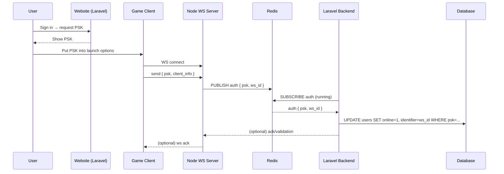
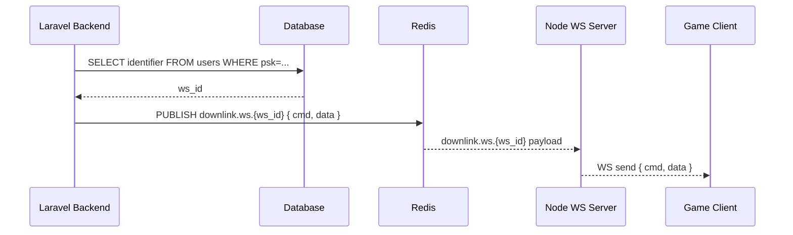

# TeamRadar — PSK Auth and Presence Flow

Updated architecture for PSK distribution and presence tracking across Site → Game Client → Node WS → Redis → Laravel → Database.

## 1) End-to-End Flow

```mermaid
flowchart LR
  U[User]
  S[Website (Laravel Web)]
  G[Game Client<br/>(Launch Options)]
  N[Node WebSocket Server]
  R[(Redis)]
  L[Laravel Backend<br/>(Consumer/Queue Worker)]
  D[(Database)]

  U -->|Sign in & request PSK| S
  S -->|Display PSK| U
  %% Arrow explicitly labeled per request
  S -->|"User pastes PSK into game <br/>launch options"| G

  G -->|Connect WS| N
  G -->|Send auth message <br/>{ psk, client_info }| N

  N -->|Publish auth event <br/>{ psk, ws_id }| R
  R -->|auth event| L
  L -->|Lookup by PSK<br/>set online = true<br/>identifier = ws_id| D

  %% Downlink: Laravel → Game via Redis → Node → WS
  L -->|Resolve ws_id by PSK| D
  L -->|Publish downlink <br/>{ ws_id, cmd }| R
  R -->|downlink event| N
  N -->|WS send { cmd }| G
```

Notes
- The label on the arrow from Site → Game Client is intentionally the instruction: “User pastes PSK into game launch options”.
- `identifier` is whatever unique handle you use to tag this connection (e.g., `ws_id`, `connection_id`, or a generated token) and is stored with the user row.

## 2) Auth + Presence Sequence



## 3) Backend → Client Messaging



## 3) Components at a Glance

```mermaid
flowchart TB
  subgraph Frontend
    S[Site (Laravel Web)]
    G[Game Client]
  end

  subgraph Transport
    N[Node WS]
    R[(Redis)]
  end

  subgraph Backend
    L[Laravel Workers]
    D[(DB)]
  end

  S -.issues PSK .-> G
  G -->|WS + PSK| N
  N -->|publish| R
  R -->|deliver| L
  L -->|persist presence| D
```

Open Questions
- What is the exact DB column name for the connection identifier? (`ws_id`, `connection_id`, etc.)
- Which Redis channel/stream naming do you prefer (e.g., `auth.events`, `presence.auth`, or a queue via `rpush`)?
- Should Node validate PSK against a cache/API before publishing, or is Laravel the single source of truth?

Implementation Notes
- Recommend Redis channels:
  - Auth upstream: `presence.auth`
  - Downlink per-connection: `downlink.ws.{ws_id}` (pattern-subscribed by Node)
- Node maintains `ws_id → websocket` map in memory; clears on disconnect. `ws_id` can be a UUID.
- Laravel resolves `ws_id` via DB by PSK (set during auth) or via a Redis hash `psk → ws_id` if you prefer ephemeral presence in Redis.
