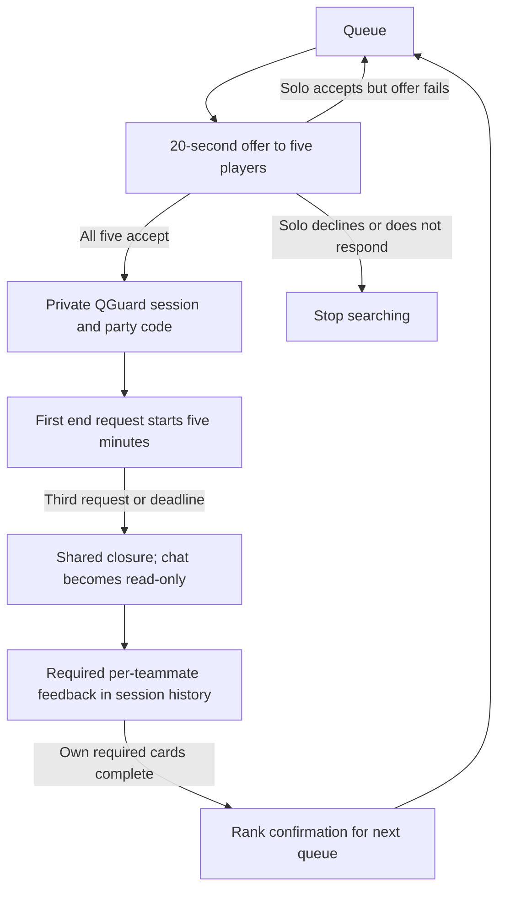

# Reconciled behavior review — 2026-10-28

**Baseline authority:** DEC-076–082; the original checks/screens below belong
to commit `6639dce`. **Current follow-up:** DEC-083/084 resolves the previously
pending premade/display choices; see the final section. Approved layout, Forest & Lime palette and brand
retained. Canonical source: [prototype](../prototype/index.html); current
[standalone](../qguard-review.html). [Application entry contract](../../../planning/review-version/reconciliation-and-implementation.md).

## What changed

- All five accept a proposed match within a common 20-second window. Reopening
  the popup does not restart time. Solo acceptors return to searching when the
  offer fails; non-acceptors stop. Premade failure remains explicitly pending.
- One end request starts five minutes; a third distinct request closes sooner.
  The session stays active during the countdown. Feedback opens on shared
  closure; completed own required cards unlock the next queue. Closed text is
  read-only. No waiting for other reviewers and no feedback expiry.
- Unanswered discrepancy blocks progression, keeps the end-request action,
  retains an unresolved closure, and creates no pre-play rating debt.
- Numerically excluded authors still see required immutable cards. Teammate
  profile views omit descriptor summaries; self-only values are marked fictional
  layout samples while the display rule remains open.
- The same generated design is packaged for `/guest`; state lives only in a
  dedicated tab-scoped sessionStorage key. No provider or business-record writes.

## Updated flow sketch

Premade failure and initial descriptor display have no inferred default here.
Pre-play disband/closure takes the no-rating path. The five-minute timer belongs
to ending a session; it is never a feedback deadline.

## Executed evidence

The real application `/guest` route served the bundled artifact to Playwright:
**22 tests passed**, with **2 intentional skips** of duplicate full-catalog
passes in Firefox/WebKit. Changed journeys ran in all three engines. Chromium
also visited **81 catalog route/state links**. The entry plus catalog itself
are covered separately; old “79” counts refer to the earlier artifact.

Assertions cover tab isolation, no guest service requests, five acceptances,
decline/timeout, fixed acceptance deadline after Escape/reopen, five-minute and
third-request closure, active/unfinished-feedback queue blocking, closed chat,
immutable per-card submission, required excluded-author cards and private
summary presentation. Changed screens render at **1440×1000** and **390×1000**
without horizontal overflow or uncaught JS errors.

The first test run mistakenly counted a normal login Livewire asset as a guest
request; the observation window was corrected to begin at guest entry. A later
catalog check selected both the auth-page hero and main heading; it now scopes
to the main heading. These were test defects, not passed product assertions.
Visual/code review also led to real fixes: preserve an existing offer deadline
on reopen and make closed-session chat/read actions truthful. The final run
includes those fixes.

[Acceptance popup](acceptance-dialog.png), [shared-end desktop](shared-end-desktop.png),
[self profile](self-profile-desktop.png), [teammate mobile profile](teammate-profile-mobile.png)
are retained representative renders. A three-engine popup-only run also passed
while recapturing its viewport after the full-page screenshot displaced sticky
background elements. The shared-end catalog picture is a frozen
layout sketch; the countdown behavior is separately exercised in browser tests.

## Evidence limits

These are **synthetic presentation tests** for the revised product behavior.
They do not prove multi-user acceptance, score calculations, persisted shared
closure, report-order concurrency, game-code validity, RSO, Discord or launch
readiness. Only guest routing/isolation and the real queue block are implemented
in R1a. The earlier first-pass backend suite continues to test its historical
engine, not the revised policies.

## Follow-up — explicit premade and descriptor answers

DEC-083 stops the entire premade if any member declines or misses the deadline,
keeping membership intact. Other fully accepted premades and accepted solos
return. The preview now differentiates failure inside the current premade from
failure by an independent solo, rather than stopping every premade.

DEC-084 requires three distinct eligible reviewers per descriptor before its
self-only summary appears. `#profile?state=new` shows no feedback, `insufficient`
shows one/two-reviewer placeholder wording, `mixed` demonstrates communication
qualified while play style is not, and the default shows both qualified.
No midpoint is presented as an observed description. Counts and values are
fictional fixtures; server counting/calculation remains for the backend slice.

**Checks:** 15 focused browser tests passed across Chromium, Firefox and WebKit.
They cover same-premade decline, own timeout, unaffected-premade return, retained
membership, no session/debt from a failed offer, existing solo recovery and
independent private descriptor states at 1440px and 390px. Source JS syntax,
bundle equality, scoped diff/whitespace and Markdown link checks also passed.
No backend/PHP changes, new image build, live API or player tests in this follow-up.
Earlier broad test totals and image hash remain dated baseline evidence.

Inspected renders: [stopped premade](premade-stopped.png),
[mixed descriptor desktop](descriptor-mixed-1440.png),
[mixed descriptor mobile](descriptor-mixed-390.png). The owner subsequently
requested committing this coherent decision/specification/preview/test batch.
It is one rollback unit, not separate commits for each answer. No remote action.
