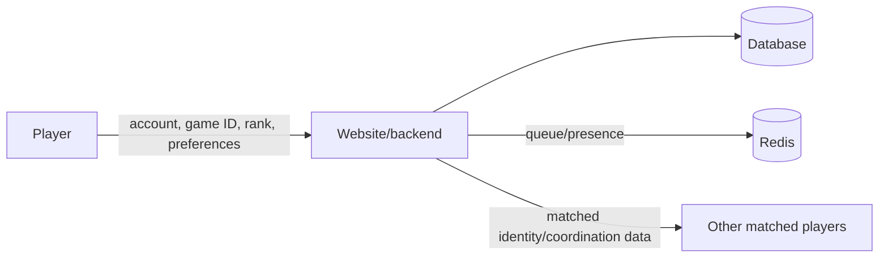
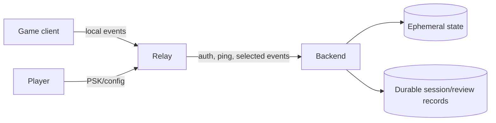
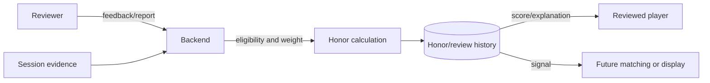

# Legacy Data, Privacy, And Security Reconstruction

- **Record type:** historical data/security audit
- **Status:** draft for owner review
- **Current authority:** none
- **Legal status:** no legal conclusion is made; no provider/deployment fact was
  inferred from code

## Verified Persisted Fields

### User

The Laravel starter model persists at least name, email, password hash,
email-verification timestamp, remember token, and timestamps through its base
migration/model.

### Game

- name;
- unique slug; and
- timestamps.

### Game Account

- owning user ID;
- game ID;
- game username;
- nullable integer rank;
- nullable `verified_at`; and
- timestamps.

One user/game pair is unique. The code currently creates a record with
`verified_at = now()` immediately after self-declared form submission.

## Planned Or Implied Data Without A Surviving Schema

- platform/account identifiers;
- current/previous rank confirmations;
- queue preferences and eligibility;
- blocks and prior pairings;
- matched groups/private rooms/readiness;
- relay tokens/PSKs and active connection/session IDs;
- presence and health timestamps;
- normalized/raw game/session events;
- session/group correlation and review eligibility;
- teammate reviews, reasons, reports, honor, and reviewer trust weight;
- moderation actions, evidence, reasons, appeals, and restoration; and
- operational logs/metrics.

No legacy record defines a complete field-level inventory, purpose, recipient,
retention, deletion, access, backup, or jurisdiction map.

## Remembered Data Flows

### Website Account And Matchmaking

### Relay And Session Evidence

### Review And Honor

The diagrams show intended conceptual flows only. The implementation does not
contain these complete systems.

## Privacy Questions Left Open

- which identifiers are necessary and which are public to matched players;
- whether platform IDs can be changed, hidden, corrected, or deleted;
- whether raw LiveAPI events are necessary or a minimal derived signal suffices;
- whether session events reveal other players who never joined TeamRadar;
- whether chat/free-text reviews are collected;
- how reports involving harassment or sensitive content are protected;
- how long profiles, events, rooms, reviews, reports, and moderation history are
  retained;
- who can access them and for what purpose;
- how export, correction, deletion, legal hold, and account recovery work;
- how backups honor deletion/restore rules;
- where processing occurs and which providers/subprocessors exist; and
- what age/consent boundary applies.

## Verified Legacy Security Findings

These findings describe old prototypes and are not fix requests for the rewrite:

- The setup component labels self-declared account/rank data as verified by
  filling `verified_at` immediately.
- The Redis verification worker derives a user ID from `crc32(psk)` instead of
  verifying the token against a user store.
- The worker logs full incoming messages and the PSK after “verification.”
- The Node gateway logs PSKs when binding users and on timeouts.
- The Laravel app exposes an unauthenticated `/redis-test` route that writes and
  reads a fixed Redis key.
- The recovered Electron relay stores its PSK in a JSON config file even though
  `keytar` is installed.
- The relay enables `nodeIntegration`, disables `contextIsolation`, and opens
  DevTools automatically; a safer preload exists but is commented out.
- The gateway listens on plaintext WebSocket by default and lacks a complete
  authorization/command policy.
- Raw Apex payloads can be written to local text/binary logs or displayed in
  the relay debug UI without a retention/redaction design.
- Development Compose embeds default database credentials suitable only for a
  local prototype.

## Identity And Token Ambiguities

The remembered later direction rejected stored IP identity and permanent PSK
identity in favor of short-lived tokens bound to active sessions. However, no
actual token lifecycle, hash/storage form, audience, scope, rotation, revocation,
rate limit, replay defense, concurrent-session rule, or recovery behavior was
specified.

The `nucleusHash` idea was explored as an identity bridge and remembered as
rejected because a public identifier could not be dependably transformed into
the observed hash. No current identity claim should rely on it.

## Recommendation And Moderation Data Risk

Honor/reputation can become consequential even if it is not legally
“sensitive” in a narrow schema sense. It can affect visibility, eligibility,
social standing, and user safety. The old design lacked:

- criteria/version history;
- reviewer eligibility and conflict controls;
- explanation/correction/appeal;
- abuse and discrimination testing;
- moderation access/audit;
- retention/deletion rules;
- monitoring for disparate or self-reinforcing outcomes; and
- rollback when a rule harms users.

## Requirements A Future Design Would Need Before Collection

This is a documentation gate, not a new product decision:

- field-by-field purpose and necessity;
- source and accuracy label;
- recipient and access role;
- storage/logging/backups;
- retention/deletion/hold;
- jurisdiction/providers;
- user explanation and controls;
- authentication/authorization/threat model;
- incident handling;
- moderation/recommendation review; and
- qualified legal/platform-policy verdict for the concrete flow.

No legacy public privacy/compliance promise should be reused without checking
the actual future deployment and data behavior.
