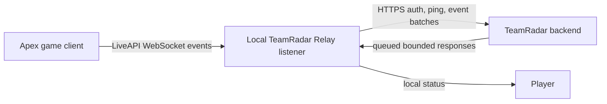
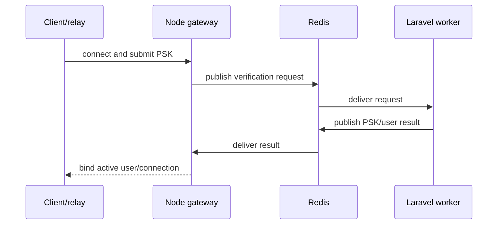

# Legacy Game Integration And Relay

- **Record type:** historical integration reconstruction
- **Status:** draft for owner review
- **Current authority:** none
- **External-fact warning:** game/platform capabilities described here are old
  internal claims; they have not been checked for current accuracy

## Why A Relay Existed In The Old Apex Idea

The remembered Apex product wanted evidence that TeamRadar-matched players
connected to the game and played together. Apex LiveAPI exposed local game
events, while TeamRadar's backend ran remotely. The relay was intended to bridge
those environments without requiring the hosted service to initiate a
connection into a player's home network.

The relay was not intended to become an autonomous game bot. Its remembered
responsibilities were:

- listen locally for Apex LiveAPI;
- authenticate the current player/session to TeamRadar;
- normalize/package events;
- forward relevant events to the backend;
- maintain presence/health;
- receive bounded responses or commands;
- buffer/retry where practical; and
- expose diagnostics to the player.

## Correct Remembered Apex Topology

The bundled Apex LiveAPI reference and the tracked `Apex-tap` proof of concept
model Apex as the WebSocket client and the local tool as the listener/server at
the remembered address `127.0.0.1:7777`.

## Prototype Topology Error

The recovered Electron relay's `src/client/liveapi.ts` opens the local LiveAPI
URL as a WebSocket client. That conflicts with the later Apex tap/listener and
the memory reconstruction. It should be understood as an incomplete early
prototype, not proof of the correct final topology.

## Recovered Electron Relay

An unreachable Git history contains four commits from 2025-10-01 through
2025-10-07, ending at `5997de0`. The tree identifies itself as
`teamradar-relay` version `0.1.0`.

### Stored Configuration

- TeamRadar HTTP base URL;
- local LiveAPI WebSocket URL; and
- PSK.

The prototype writes JSON to Electron's user-data directory. Although `keytar`
is a package dependency, the inspected code does not use it to protect the PSK.

### HTTP Gateway Client

The recovered client proposes:

- `POST /relay/auth` with PSK and client/version metadata;
- `POST /relay/ping` every 15 seconds while authenticated;
- `POST /relay/event` for normalized game events;
- automatic authentication retry after two seconds; and
- reauthentication when a ping fails.

No corresponding Laravel routes/controllers are implemented in the surviving
tree, so this is only one side of a protocol sketch.

### Event Envelope

The relay maps a JSON event to a simple shape:

- `k`: event kind;
- `ts`: Unix timestamp;
- `d`: event data; and
- optional `id`.

The mapping falls back to `apex.raw`. No schema version, field minimization,
validation, ordering, size limit, privacy filter, or compatibility contract
was defined.

### Status And Diagnostics

The recovered UI includes:

- gateway and LiveAPI status indicators;
- connection/auth/alive/error/retry messages;
- successful ping and forwarded-event counters;
- a timestamped log;
- filtering;
- optional raw payload display;
- Save Settings and Save & Connect actions; and
- automatic reconnect behavior.

The UI gives useful troubleshooting feedback but can expose PSKs or raw game
data if logging/redaction is not designed carefully.

## Remembered PSK Model

The memory reconstruction says the intended PSK was:

- user/session-specific;
- short-lived or replaceable;
- used to authenticate the active relay/session;
- entered/stored by the relay rather than inferred from IP; and
- bound to an active connection identifier.

Exact issuance, expiry, rotation, revocation, single-use behavior, concurrency,
storage, recovery, and redaction were never settled.

The tracked worker does not validate a PSK against a user store. It derives a
placeholder numeric user ID from `crc32(psk)` and logs the PSK. That is test
scaffolding, not authentication.

## Remembered HTTP MVP Reliability Plan

The HTTP polling choice was intended to work through normal outbound HTTPS and
avoid inbound NAT/firewall complexity. The memory reconstruction anticipates:

- local buffering;
- retry with bounded backoff/jitter;
- command identifiers;
- acknowledgements;
- deduplication/idempotency;
- reauthentication;
- reconnect to both Apex and TeamRadar; and
- presence expiry when pings stop.

Only periodic ping, event forwarding while authenticated, simple reconnect,
and a retry loop appear in the recovered client. No durable buffer, ack,
deduplication, idempotency, or command protocol was found.

## Hosted WSS And Redis Path

The tracked `gateway/index.mjs`, worker, architecture diagram, and feature-parity
checklist explore a future hosted WebSocket design:

Surviving variants disagree about:

- whether authentication is required;
- Redis key/channel naming;
- which component validates PSKs;
- whether presence lives in Redis or the database;
- socket/user map persistence;
- inbound event publication;
- outbound per-user subscriptions; and
- cleanup on disconnect.

The active gateway handles a verification handshake but lacks the full relay
features listed in `docs/gateway-comparison.md`. Large alternate versions remain
commented in the same file.

## Apex Custom-Match Exploration

`Apex-tap/index.mjs` can encode a `customMatch_CreateLobby` request and the
bundled proto includes other custom-match operations. The memory reconstruction
says the project later rejected these as the core pubs workflow because custom
matches do not automate ordinary public/ranked party formation.

The tap is incomplete: its binary handler references an undefined `buffer`
identifier instead of the received `data`, so that path would fail when reached.

## Valorant Detour

The late TODO explored browser access to local client endpoints, official Riot
APIs, RSO, PUUID, match history/rank, lobby codes, and an API-light prototype.
The implemented branch only accepts self-declared Riot ID/rank and gates a
static page. None of the integrations exists in the codebase, and their present
availability or permitted use has not been researched here.

## Missing Integration Contracts

- current official platform-policy evidence;
- exact user consent/onboarding;
- local listener ownership and port conflicts;
- event allowlist and minimization;
- schema/version negotiation;
- authentication/token lifecycle;
- group/session correlation;
- command allowlist and authorization;
- retry/backpressure/buffering/idempotency;
- telemetry/log redaction and retention;
- offline/update/support behavior;
- installer signing and trusted update channel; and
- complete integration tests with deterministic fixtures.

No part of this legacy design selects the rewrite's integration model.
