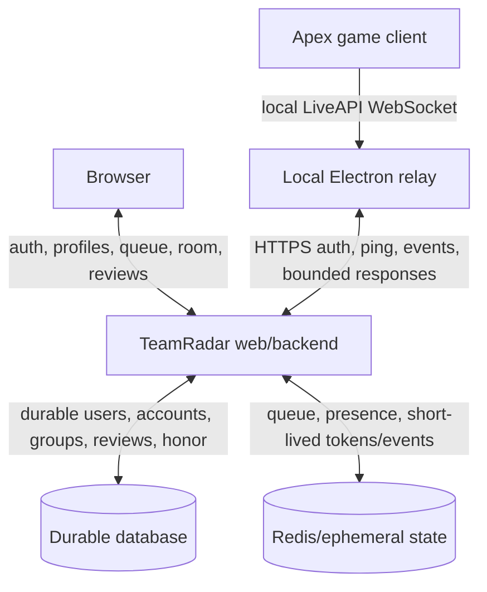

# Legacy System Architecture

- **Record type:** historical architecture reconstruction
- **Status:** draft for owner review
- **Current authority:** none

## Two Different Architectural Views

The legacy record contains:

1. a **surviving implementation baseline** centered on Laravel/Livewire and
   static prototypes; and
2. an **intended Apex relay architecture** that was never completed end to end.

They must not be presented as the same thing.

## Surviving Repository Baseline

### Web Application

- PHP `^8.2` and Laravel `^12.0`;
- Livewire Flux and Volt;
- Blade views;
- Laravel starter authentication/settings;
- Vite 7, Tailwind CSS 3, PostCSS, and Axios;
- Pest 3 test dependencies; and
- Composer scripts for local multi-process development.

### Durable Data

- user schema from Laravel starter migrations;
- `games` table with unique slug;
- `game_accounts` table with user/game foreign keys, username, nullable integer
  rank, nullable `verified_at`, timestamps, and unique user/game pair; and
- MySQL configured as the active Compose database service.

### Ephemeral/Realtime Experiments

- Redis dependency/configuration;
- a public `/redis-test` diagnostic route;
- a Laravel Redis verification worker;
- a Node WebSocket gateway;
- an Apex local WebSocket/protobuf tap; and
- architecture notes describing PSK, presence, and downlink routing.

### Container Configuration

- PHP-FPM app;
- Vite dev server;
- Nginx on host port 8080;
- MySQL 8;
- Redis 7;
- named database and Vite dependency volumes; and
- commented gateway and verification-worker services.

The Compose file is development configuration, not evidence of a production
deployment. No services were running during inspection.

## Remembered Apex MVP Architecture

This model puts Laravel/the backend in a control-plane role, the database in a
durable-record role, Redis in an ephemeral/coordination role, and the relay at
the local game boundary.

## Intended Component Responsibilities

### Browser/Web UI

- account and game-account setup;
- queue entry/state;
- matched-team room and manual coordination;
- rank/honor display;
- post-session review/report; and
- support/moderation touchpoints.

### Backend

- authorization and user ownership;
- queue and candidate matching;
- group/room lifecycle;
- token/relay session issuance;
- session evidence ingestion/correlation;
- review eligibility;
- honor calculation;
- report/moderation state; and
- auditable decisions/explanations.

None beyond basic account/game-account scaffolding is implemented.

### Durable Database

Historically intended to store long-lived users, linked accounts, groups,
sessions, reviews, honor, and moderation state. Only users/games/game accounts
exist in surviving migrations.

### Redis

Historically proposed for short-lived PSKs, presence, socket bindings, queues,
and pub/sub. The actual key/channel/source-of-truth contracts were inconsistent
and unsettled.

### Local Relay

Intended to bridge local game events to the hosted service, maintain health,
and show diagnostics. It survives only as unreachable prototype commits.

### Node Gateway

Considered a later WSS path for long-lived sockets and Redis-mediated routing.
It was not required by the remembered HTTP-polling MVP and is incomplete.

## Architecture Claims Not Supported By Implementation

The legacy overview states or strongly implies:

- matchmaking APIs;
- PSK issuance;
- HTTP ping/pong relay endpoints;
- lobby verification;
- Redis-driven ingestion and command flow;
- gateway/worker orchestration; and
- end-to-end relay behavior.

The surviving app has empty API controllers, no API route registration, a
placeholder PSK worker, a static matchmaking page, and commented Compose
services. These claims describe intended architecture, not completed behavior.

## Frontend And Rewrite Ambiguity

The code proves Blade/Livewire/Volt/Flux as the latest Laravel frontend. The
memory reconstruction says React/Vite appeared in earlier descriptions and a
later learning-oriented rewrite discussed Node/TypeScript, NestJS, Prisma,
PostgreSQL, Redis, and React.

No surviving current decision makes React, Livewire, NestJS, Laravel, MySQL,
SQLite, or PostgreSQL the rewrite stack.

## Architectural Quality Attributes That Were Implied

- low-friction local onboarding;
- resilience to NAT/firewalls;
- reconnect/retry behavior;
- short-lived authenticated sessions rather than IP identity;
- traceable session/review relationship;
- simple initial hosting;
- eventual TLS, hardening, observability, and rollback; and
- scalable realtime transport later if product value justified it.

These were intentions, not measurable acceptance criteria.

## Missing Architecture Decisions

- approved user journey and service boundary;
- API/event contracts and versions;
- authorization model;
- persistent schemas and state machines;
- queue/match consistency and concurrency;
- review/honor criteria versioning;
- token/secret lifecycle;
- privacy/data retention;
- reliability/SLOs/backpressure;
- observability and incident response;
- backup/restore/rollback;
- deployment/provider facts;
- desktop update/signing; and
- threat model/security review.

The rewrite should select architecture only after its product and permitted-use
boundaries are approved.
